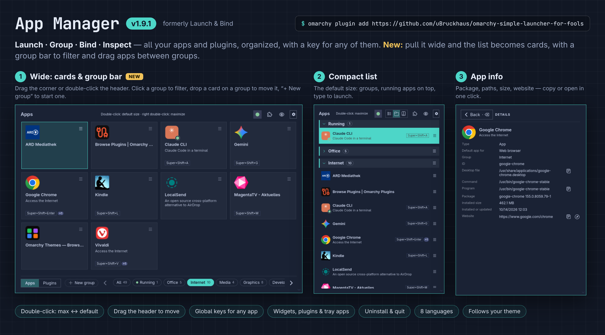

# App Manager

**Launch · Group · Bind · Inspect.** All your apps and plugins in one theme-aware popup and bar widget for [Omarchy](https://omarchy.org): type to launch, sort them into your own groups or by origin, give any of them a global key on a key map that shows who owns every key, and look up where each one lives, how big it is and when it was installed.



**New in 2.0:** an optional **dock**, **folders**, **drag & drop everywhere**, **update and new-app marks** and **your own icons**. Pin apps to a dock on any free screen edge (auto-hide, grow on hover, bounce on alerts, your colours); pull the popup wide for **group folders** like a start menu, drag apps between groups and into the dock, and reorder anything with a visible drop bar; see at a glance which apps and plugins have **updates** (update plugins in one click) and which are **newly installed** (★); give apps without a good icon an original one with **Change icon…**. Settings show an animated preview of every option and have **Reset to defaults**. Details below.

**New in 1.9:** **cards and a group bar.** Pull the popup wide (corner grip) or double-click its header, and the list becomes **cards in columns** (up to six) with a **group bar** at the bottom: Apps | Plugins, **+ New group**, then All, Running and your groups. Click a group to show only it, **drag a card onto a group** to move it there (or onto + New group to start one), right-click a group for rename, move and delete. The popup **resizes**, **moves** (drag the header) and remembers both; **double-click the header** to maximize or go back to the default size.

**New in 1.8:** Launch & Bind is now called **App Manager**, because it does much more than launch and bind: **your groups** (Office, Media, … or your own, apps and plugins each with theirs), **by origin** (your default apps, what came with Omarchy, what you added), **App info** (path, package, size, install date, website, copy and open buttons), **running apps first**, and a much faster list. Nothing else changes: the plugin ID, install path, settings and your shortcuts stay as they are.

**New in 1.7:** the launcher speaks eight languages (English, German, French, Spanish, Italian, Portuguese, Dutch, Polish) and follows your system language; a settings page (gear ⚙, top right) to pick another one; and an optional **Open as administrator** action, off until you switch it on there.

**New in 1.6.2:** Simple Launcher was renamed **Launch & Bind** (now App Manager). Nothing else changes: the plugin ID, install path, settings and your shortcuts stay as they are.

**New in 1.6:** shortcuts of uninstalled apps are cleaned up right away, and hand-written ones in your Hyprland files are deleted only after you say yes; menus open on their first entry, mouse and keyboard share one highlight, and Left or Backspace closes a menu again; **Uninstall…** explains how to remove browser web apps (Chrome, Brave, …) and tells you when it fails; the list keeps its height and its search when switching lists.

**New in 1.5:** put widgets into the bar (left, center or right) or take them out, right from the widget list.

**New in 1.4:** a second list for Omarchy **widgets, plugins and running tray apps** (Steam, NordVPN, LM Studio, …) with their own menus and shortcuts, **Uninstall** for marketplace plugins, **Quit** for background apps, **two-step shortcuts** (`Super + Alt + Space`, then `N`), keys captured just by pressing them, and separate keys for the app list and the widget list.

## Advanced shortcuts

Open an app's menu (`☰`, `→`) → **Shortcut…**, or press `Ctrl+K`.

- **Shortcuts for app actions**: a key can open the app or one of its own desktop actions. Example: give Brave's **New Incognito Window** `Super + Shift + Alt + B`. The `☰` menu shows each action's shortcut next to it.
- **Every key, coloured by owner**: with modifiers selected, all letters and keys like Enter or Space are shown — green when free, yellow when one of your bindings has it, orange for an Omarchy default.
- **One-click rebinding**: taking over a key is an option, not an error. **Rebind** turns the old binding off while your shortcut exists; remove the shortcut and the original works again.
- **All shortcuts of an app in one place**: launcher-made ones, your own `bindings.lua` binds and Omarchy defaults (including your default terminal, browser and editor, e.g. `Super + Enter` → Foot). Change, remove or turn off any of them; a `+1` badge in the list shows apps with more than one.
- **No duplicates, no edits to your files**: a key that already opens the same thing is never added twice. Everything lives in a generated `~/.config/hypr/simple-launcher-shortcuts.lua`, validated with `hyprctl configerrors` and rolled back if Hyprland rejects it.

## Changes in 2.4.1

**AppImage scan, more exact.** Only the program a desktop entry starts counts as its AppImage, not a file it opens with another program, and the `.AppImage` extension is matched in any case. Exec lines through `env` (also `/usr/bin/env`) skip its options and `VAR=value` words, so the real program is checked; forms like `env -S` or `env -C DIR` check `env` itself, and a path with a NUL byte counts as not runnable instead of stopping the scan. Names keep words that only start with a digit ("Foo-3D-1.0" → *Foo 3D*) and CPU names count only as words of their own. Of several versions, the final release beats its prereleases (rc > beta > alpha), `+build` metadata does not count, and the newest version stands for the older ones even when their built-in names differ.

**App window on other desktops.** Outside Omarchy, App Manager's window can get narrow again after it was made wide. The Omarchy popup is unchanged.

**App icon size.** Settings has **App icon size** (32 to 64 px, 44 by default), like the dock's *Icon size*: the icons on the cards get that size, those in the list 12 px less. **Reset** sets it back.

**Safer Quit, entries and icons.** **Quit** for an app that runs only in the background (and has no Quit entry of its own in the tray) ends only processes of the app's own executable: the program its entry starts, resolved to its real path, must be the very file `/proc/<pid>/exe` points to; a program with the same name in another folder does not count. Apps that run through a shared interpreter or wrapper (`python3.14 app.py`, `node`, `bash`, `env`, `flatpak` and the like), in a terminal, as a browser web app, and apps whose executable another desktop entry starts as well (`libreoffice --writer` / `--calc`; hidden entries and the actions of other entries count too) get no **Quit** this way, because their processes cannot be told apart from other programs. Right before the signal, each process is checked again through a pidfd for the same executable and the same start time as when the menu was built, so a process number reused meanwhile by another program is never hit. Desktop entries are read only when they are regular files of at most 256 KiB, opened without blocking, so a FIFO or a huge file in an applications folder can neither freeze nor exhaust the popup or the dock. An entry whose `env` prefix sets or clears `PATH` (`env PATH=… prog`, `env -i prog`) is no longer hidden because App Manager's own `PATH` lacks the program: `env` itself is checked. Icon files are opened without blocking and read only when they are regular files, so an icon path that a tray app swaps for a FIFO cannot freeze the popup.

## Changes in 2.4.0

**Switch to window.** An app with open windows gets **Switch to window** in its menu, in a section of its own above **Shortcut…**. With one window it goes straight there (its workspace shows and the window gets the focus); with several, **Switch to window ›** lists each window by its title with its workspace, and a click switches to that one. App Manager asks Hyprland with `hl.dsp.focus({window = "address:0x…"})` (only a hex window address from `hyprctl clients -j` is ever put into it) and, should that dispatcher be refused, with the classic `focuswindow`, as Omarchy's own `omarchy-launch-or-focus` does.

**No more duplicate AppImage entries.** AppImages that an installer gave a desktop entry (e.g. the Craft apps' `photocraft-0.14.0-linux-x86_64.AppImage` → *PhotoCraft*) no longer show up a second time as "photocraftlinux x86" without an icon, and neither do older versions of them lying next to the new one. Names guessed from a file name drop the version, `linux` and CPU parts; of several versions without a desktop entry only the newest is listed.

**Information page from the marketplace.** The ⓘ page's cards now come from the marketplace's catalog, so newly published plugins of the author appear without an App Manager update (see *Privacy and network*); a plugin this version does not know yet shows the first sentence of its marketplace description, in English. The layout is unchanged.

**Omarchy 4.0 and 4.5.** Your own `o.rebind(…)` and `o.bind_hold(…)` lines (helpers new in Omarchy 4.5) are now recognised as your bindings on the shortcut page instead of being labelled Omarchy defaults.

## Changes in 2.2.0

**Open in floating window.** Every app's menu has **Open in floating window**: its first window opens floating (movable and resizable) even on a tiled workspace. App Manager asks Hyprland to start it with the float rule (`hyprctl eval 'hl.exec_cmd(…, {float = true})'`); the command is the same `uwsm-app -- <app>.desktop` as a normal start, shell-quoted and passed to Lua with every byte escaped, so nothing in a file name can reach the code around it.

**Open on workspace.** Every app's menu has **Open on workspace ›**: pick one of the workspaces in use (each shows the apps on it) or the next empty one, and the app's first window opens there; that workspace then shows. Same start as above, with Hyprland's workspace rule (`{workspace = N}`, N a number from 1 to 100) instead of the float rule.

**Look.** Settings → **Look**: *Omarchy theme* (the default, as before) or *GNOME (Adwaita)* for libadwaita's own widgets and colours. App Manager restarts itself to switch.

**Filter field.** Settings → **Filter field** (on by default), or the × next to the wide view's filter field, hides the field. Typing still filters; the title then shows what you typed. *Reset to defaults* brings it back.

**Legend.** The ⓘ in the header explains every mark in the list: running dots, update dot, ★ for new apps, the eye for hidden ones, plugins not in the bar, shortcut chips and +N.

**No more red "missing" icons.** Icons that a stale icon-theme cache does not list are found in `hicolor` and `pixmaps` directly; apps without any icon get the generic application icon in the popup and the dock.

## Changes in 2.1.0

**Folders fill the popup.** Resize the wide popup and the group folders grow or shrink with it: App Manager picks the number of folders per row that gives the largest icons (36–96 px), spreads the icon rows over the height, and fits again when you add or delete a group. With more groups than fit at the smallest size, the page scrolls as before.

**Corners.** A new setting for the popup, its folders and cards, and the dock: **Like windows** (the default) follows Hyprland's window rounding — set by the current theme's `hyprland.lua` or your `~/.config/hypr/looknfeel.lua`; the tooltip says which — or **Rounded** (12 px) or **Square**. The animated previews in the settings show it. The dock's *Rounded corners* uses the same radius (12 px when the popup is square).

**New groups.** After **+ New group** the popup stays on *All*; the new group's folder, chip and heading carry a ★ until its first entry is put in it. The name field has the keyboard focus.

**Better icon search.** **Change icon…** searches the name lists of three open icon collections (Dashboard Icons, selfh.st icons, Simple Icons — about 9,900 icons) by name, alias and word instead of guessing file names; up to 24 matches, best first, each shown as soon as it has downloaded. When the CDN lacks one format of an icon, the other (SVG or PNG) is tried.

## Changes in 2.0.0

**Dock (optional, off by default).** Settings → **Dock** → *Show dock*. A bar of app icons on a screen edge: the App Manager button, your **pinned apps** (drag to reorder, a bar shows where they land), then the **running apps** that are not pinned, as on macOS. Click starts an app or brings its window to the front (again: the next window), middle-click opens a new window, right-click gives Open / its own actions / Pin or Unpin / Close. Pin apps with **Pin to dock** in their App Manager menu or by **dragging them from App Manager onto the dock**.

| Dock setting | Choices | Default |
| --- | --- | --- |
| Position | Bottom, Top, Left, Right — never the bar's edge; if the bar moves onto it, the dock takes the opposite edge | Bottom |
| Auto-hide | Hidden until the pointer touches the edge; off: the dock keeps its space and windows tile next to it | Off |
| Full length / Icons | Compact and centred, or the whole edge with the icons at its start, centre or end | Compact, centre |
| Rounded corners / Transparent | Corners like the windows; no background, only the icons (double-click the dock's background to switch, as on the bar) | Off / Off |
| Dock height / Icon size | 32–96 px / 24–96 px; icons larger than the dock stick out of it | 48 / 32 px |
| Icon spacing | The gap between two icons, 0–16 px | 6 px |
| Grow on hover | Off or 125–200 %: the icon under the pointer grows, its neighbours halfway | Off |
| Bounce on alerts | An app that wants attention (Hyprland's *urgent*) bounces until you switch to it | Off |
| Show indicator / Indicator / colour | Marks running apps with a line or a dot, in the theme's accent or a palette colour | On / Line / Theme |

The dock is its own small process (`dock.py`), started by the bar widget when the shell loads; it quits by itself when switched off. While App Manager is open the dock stays visible and App Manager leaves exactly the dock's area free, so you can drag apps onto it; App Manager only closes on a click outside both. It reads Hyprland's event socket for windows opening, closing, focus and *urgent*.

**Folders.** With **Layout when wide** = *Folders* (the default), the wide popup shows each group as a folder of icons, all the same size (3 × 3, more scroll inside). The folders grow and shrink with the popup to fill it, and fit again when a group is added or deleted (icons 36–96 px; with too many groups for the smallest size the page scrolls). Click an icon to start it, the folder to open the group (Esc or Backspace goes back), right-click an icon for its full menu, the folder for rename / move / delete. A filter field sits above the folders. **Layout when small** picks the list, groups or by origin for the small popup.

**Drag & drop everywhere.** Drag an app from a folder, a card or a list row onto another folder, a group chip or between two icons; drag a group chip or a folder to reorder the groups. A bright bar shows exactly where it will land (left half of the target: before it, right half: after). Your order is kept in `groups.json` and used in every view.

**Updates.** Apps whose package has a newer version (repositories via `checkupdates`, AUR via `yay -Qua`) and plugins whose git checkout is behind its remote's default branch get an **Update** mark. Plugins: **Update** in their menu runs `omarchy plugin update <id> --yes` in the background (fast-forward only, validated, rolled back on failure) and tells you how it went. Apps: **Update system…** opens Omarchy's own update window, because a single package is never updated on its own on Arch. Checked in the background at most every 30 minutes.

**Newly installed.** Apps and plugins installed in the last seven days get a small yellow **★** until you open them. App Manager remembers what it has seen in `~/.config/applauncher/seen.json`; the first start records what is already there, CLI agents are dated by their install.

**CLI agents.** Coding agents installed with mise through Omarchy (Codex, Cursor Agent, Copilot, OpenCode, pi, …) appear as apps that open in a terminal — only when really installed (Omarchy writes a wrapper for every agent it offers).

**Change icon…** in an app's menu: original icons from three open icon collections on cdn.jsdelivr.net (Dashboard Icons, selfh.st icons, Simple Icons), searched by name, alias and word (up to 24 matches, best first, shown as they arrive), or your installed icon themes; *Reset to default* goes back. Stored in `~/.config/applauncher/icons.json` and `~/.local/share/applauncher/icons/`.

**Settings** are grouped in cards with **Reset to defaults**; in the wide popup each card has an **animated preview** of what its options do. Option names are larger and easier to read.

**Sturdier.** All calls to `hyprctl` run off the main loop; a watchdog ends App Manager or the dock if their main loop ever hangs for 20 s (it writes where to `~/.local/state/applauncher/hang.log` / `dock-hang.log`), so a hang can never block the desktop.

## Privacy and network

App Manager sends nothing about you anywhere. It uses the network only for these, each read with a size limit and a deadline:

- **Plugin updates:** `git fetch origin HEAD` in the git checkouts under `~/.config/omarchy/plugins` (the same as `omarchy plugin update`), at most every 30 minutes while App Manager is used.
- **Package updates:** `checkupdates` (a private copy of the package database) and `yay -Qua` for AUR packages, at most every 30 minutes.
- **Information page (ⓘ):** only when you open it, at most once an hour, `curl --proto =https --max-redirs 0` to the marketplace's catalog `https://raw.githubusercontent.com/omacom/omarchy-plugin-marketplace/main/site/catalog.json` (at most 40 MiB and 40 s; with the last `ETag`, so an unchanged catalog is not downloaded again). Only the author's own entries (repositories under `github.com/ubruckhaus`, at most 60) are kept, as id, name, version, description text and the marketplace's verified flag, with the time of the last check and the `ETag`, in `~/.cache/applauncher/plugin-catalog.json` (written atomically). Offline, the cached list or the built-in one is shown. A failed attempt counts as well, so it is never tried more than once an hour.
- **Change icon…:** only when you search, `curl --proto =https --max-redirs 0` to `cdn.jsdelivr.net`: the three collections' name lists (at most 4 MiB each, cached in `~/.cache/applauncher/icon-index/` and fetched again after a week) and icon files (at most 1 MiB, checked like every other icon before it is shown).

## Changes in 1.9.2

**No more "Invalid Desktop Entry ID" warning.** Omarchy names web apps after their title (`Google Maps.desktop`), and uwsm-app shows a warning notification for a desktop file name with spaces. App Manager now starts such entries (list, actions and shortcuts) through a symlink with a valid name in its private folder `~/.local/state/applauncher/desktop-ids/`; the entry itself is unchanged. If that folder is not a private directory of yours, the entry is started as before.

## Changes in 1.9.1

**Typing to filter the cards keeps every group.** While you type, the cards show all matches and the group bar keeps every group (with the number of matches in it), so a card can be dragged to any of them; the group of the selected card is outlined. A chip clicked while typing narrows the matches to that group. Drop a card on a group while typing, and that group is shown once you clear the filter, with the card selected.

## Changes in 1.9.0

**Resizable and movable.** Drag the grip in the bottom-right corner to resize; drag the header (hand cursor) to move the popup. Size and place are kept in `~/.config/applauncher/settings.json` (`size`, `position`); the card always stays on screen.

**Double-click the header.** At the default size either button maximizes, maximized either button goes back to the default size; in between, a left double-click restores the default size and a right double-click maximizes. Both come back centred. A small hint in the header says what a double-click does right now. Double-clicking the grip also restores the default size.

**Cards and a group bar.** As soon as the popup is wide enough for two cards, the list turns into cards (icon with the running dot, name, description, shortcut, `☰` menu, right-click for the same menu), up to six columns. The bar at the bottom has an **Apps | Plugins** switch, **+ New group** (click to name one, drop a card on it to start one with that card), and one chip per group with its count: **All**, **Running** and your groups. Click a chip to show only that group; `Ctrl+G` / `Ctrl+Shift+G` step through them; right-click a group chip to rename, move or delete it. Drag a card onto a group chip to move it there. When there are more groups than fit, the bar scrolls (wheel, ‹ › buttons). Arrow keys, `Home`/`End` and `Page Up`/`Page Down` move between cards, `Enter` opens, the `Menu` key opens the `☰` menu. Narrow again, it is the familiar list.

## Changes in 1.8.0

**New name.** Launch & Bind is now **App Manager**; the plugin ID `ubruckhaus.simple-launcher-for-fools`, its folder, settings and shortcuts are unchanged.

**Faster.** The list builds once and is cached: switching between apps and plugins is instant, and the plugin page is read in the background when the popup opens.


**Groups.** The list/folder switch in the header (`Ctrl+G`) shows each page as a plain list or in **collapsible groups**. Apps and plugins keep their own pages (`Tab`) and their own groups: apps start in Office, Internet, Media, Graphics, Development, Games, System or Utilities by their desktop categories; plugins in System, Network, Media, Home or Tools by their bar category; the rest in Other. Tray icons stay on top of the plugin page as **Running in the bar**. **Group ›** in an entry's `☰` menu moves it to another group or a **New group…**. A group heading folds with a click, `Enter` or `←`/`→`. A heading's own `☰` has **Rename…**, **Move up/down**, **Delete group** (asks first; its entries go back to their suggested group) and **New group…**. Groups are kept in `~/.config/applauncher/groups.json`.

**By origin.** The third part of the switch (the box) sorts each page into **Your default apps** (your browser, terminal, mail, file manager, text editor, … from `mimeapps.list` and the terminal list), **Comes with Omarchy** (packages Omarchy installs and its own web apps and launchers, from Omarchy's package lists and pacman's database) and **Other**; on the plugin page **Built into Omarchy** and **Other**. `Ctrl+G` steps through list, groups and origin.

**Details.** **Details…** in an app's or plugin's `☰` menu shows what it is and where it lives: type, whether it came with Omarchy (installed with Omarchy, one of Omarchy's own web apps and launchers, or built into Omarchy) and what it is your default app for (web browser, terminal, email, files, text editor, …), group, ID, desktop file, command and program; for packages the pacman package, version, installed size, install date and website; for AppImages the file size and date; for plugins the version, author, licence, folder, size on disk and, for git checkouts, the source, commit and install date. Paths and addresses have a copy button.

**Open as administrator, safer.** Switching it on now asks for your password, and it switches itself off at your next login (it is kept for the current session only, no longer in `settings.json`).

**Steps aside for Omarchy's menus.** While App Manager is open, Super + Space (Omarchy's menu), the clipboard, emoji and image pickers, shell panels or Theme Manager open at the first press: App Manager watches Hyprland's event socket for those layers and closes itself. The Super key alone does nothing, so Super + drag still moves windows.

**Running apps first.** The dot button at the front of the header puts running apps in a **Running** group on top; it is green while any app runs and grey otherwise.

## Changes in 1.5.0

**Bar placement from the widget list.** Every widget with something to open is listed, in the bar or not. Bar parts with nothing to open — Workspaces, System tray, Indicators, Keyboard layout, or widgets like Simple Recipes whose icon only runs a command — are not listed at all. A widget's `☰` menu has **Remove from bar** or **Add to bar ›**, which asks for the section — **Left**, **Center** or **Right**, the widget's own default marked (Omarchy's `omarchy plugin disable` / `enable <id> <section>`); widgets that are not in the bar count as hidden: they show (dimmed, marked *Not in bar*) only while the eye shows hidden entries, so a removed widget leaves the list and comes back with **Add to bar**. Launch & Bind's own entry always stays. A widget out of the bar has no **Open** and no **Shortcut…** until it is back, because its panel opens from its bar button. **Hide from list** stays separate: it only hides the entry in the launcher.

## Changes in 1.4.1

New marketplace preview and description that show the app list first. No code changes.

## Changes in 1.4.0

A second list for Omarchy shell **widgets & plugins** (Audio, Bluetooth, Clipboard, Emojis, Weather, Omamail, …). The puzzle-piece button next to the eye switches between apps and widgets (or press `Tab`); the grid button switches back. The widget list has its own show-hidden toggle, and its `☰` menu works like the app menu: **Open**, **Shortcut…** (`Ctrl+K`) and **Hide from list**. A widget shortcut toggles it like Omarchy's own `Super + Ctrl + V` does for the clipboard, and Omarchy defaults like that one show up on the shortcut page. Only plugins the shell can open are listed; bar widgets that just run a command when clicked are left out. Hidden widgets are saved in `~/.config/applauncher/hidden-plugins.json`.

Running **tray icons** (Steam, NordVPN, LM Studio, Antigravity, …) are listed first in the same list, under **Running in the bar** (apps like Steam stay in the app list too). Electron apps share a generic tray Id, so their icons are told apart by title. Icons without a primary action of their own (Steam) open their app instead. Their `☰` menu is the icon's own tray menu, submenus included (NordVPN's country list scrolls, **Back** goes up a level), with checkmarks for toggles. Enter or a click opens the app (Steam's window); icons that are only a menu, like NordVPN, open their menu instead. **Shortcut…** can bind the icon or any entry of its menu, e.g. `Super + Alt + L` → Steam › Library; the shortcut runs `tray.py <id> <entry>`, which finds the icon again after the app restarts. An entry whose label changes (NordVPN's *Secure my connection* while connected) only works while it carries that label.

Apps that run in the background or in the tray get **Quit** in their app menu (next to **Close**, which only closes windows): it uses the app's own tray entry (*Quit LM Studio*, *Exit Steam*) for a clean exit, or ends the process of a windowless background app. In a tray icon's own menu its Quit entry stays pinned below long lists.

Installed plugins — from the marketplace, `omarchy plugin add` or linked — have **Uninstall…** in their menu, like apps; Omarchy's built-in ones do not. It runs `omarchy plugin remove`, which disables the plugin, unloads it and removes its folder (plain folders are kept as a backup, links are only unlinked). Git checkouts are deleted, so the confirmation says when that would lose work: changed files, unpushed commits, or a repo without upstream. Launcher shortcuts of a removed plugin are dropped. A tray icon's **Uninstall…** uninstalls its app (Steam).

New plugins show up in the open list on their own, like newly installed apps: the launcher watches `~/.config/omarchy/plugins` and the shell's `shell.json`, and tray icons appear and disappear as their apps start and quit.

**Just press the keys**: while the shortcut page is open, the launcher switches Hyprland to an empty submap, so every combo reaches the page — even ones Hyprland or Omarchy already use (e.g. `Super + Alt + Space`, the Apps menu) — instead of running. Leaving the page switches back; `Super + Escape` does too, should the launcher ever fail to. Press a combo, then within about a second a key on its own, and it becomes a two-step shortcut automatically.

**Two-step shortcuts**: tick **Two steps** on the shortcut page, choose the first combo (e.g. `Super + Alt + Space`), then the second key on its own (e.g. `N`) — press it or click a letter; a second click clears it, like every key button. Several shortcuts can share a first combo, each with its own second key; the letters show which second keys are free. The first combo enters a Hyprland submap where the second key runs the shortcut and any other key cancels. A first combo cannot open anything by itself, so it conflicts with one-step shortcuts on the same keys (shown and rebindable like any other conflict).

**App Manager** itself is in the widget list too: Enter or **Shortcut…** opens its shortcut page, so the keys that open the launcher are set the same way as any app's.

Its `☰` menu has **Show apps** and **Show widgets & plugins**, and on the shortcut page **Opens** offers the same choice, so each list can get its own key (e.g. `Super + Alt + A` for apps, `Super + Alt + W` for widgets). Such a key opens the launcher on that list, switches an open launcher over to it, and closes it when that list is already showing. By hand: `launcher-toggle apps` or `launcher-toggle plugins`.

## Changes in 1.3.5

The shortcut page has no visible scrollbar (wheel, touchpad and keyboard scrolling still work) and uses the same left and right gaps as the app list. **Assign** now sits beside the key being defined instead of below all keys.

## Changes in 1.3.4

Adding a shortcut always starts from the default modifiers (Super + Shift unless changed with **Default for apps without a shortcut**), also for apps that already have one, and after cancelling a change.

## Changes in 1.3.3

The app list no longer shows a scrollbar; wheel, touchpad and keyboard scrolling still work. The app-menu buttons and the show/hide hidden-apps button now share one column, with the same gap to the right edge as the app icons have to the left.

## Changes in 1.3.2

Open app menus survive background running-status updates, app-directory refreshes, and temporary focus loss. Escape closes the app menu before clearing search or dismissing the launcher.

## Features

- **Omarchy Bar Widget**: Sits natively in the Quickshell top bar as an app-grid button. Click to toggle the launcher on and off.
- **Wayland Layer-Shell Overlay**: Built on GTK4 Layer Shell for zero-latency, buttery-smooth appearance above all windows.
- **Theme Harmony**: Automatically loads and syncs with Omarchy's active theme palette (`~/.local/state/omarchy/current/theme/colors.toml`). Accent colors, selections, and background match your desktop styling dynamically.
- **Instant Search**: Start typing anywhere to immediately filter applications. Supports backspace and Escape to clear.
- **Running App Tracking**: Inspects Hyprland client states and running processes in real-time. A badge on the app icon shows green for open windows and amber for apps running in the background, so shortcut badges stay aligned. Terminal apps such as `foot -e claude` count as their own app, not as the terminal.
- **PWA & AppImage Support**: Automatically scans `.desktop` files, Chromium/Chrome Progressive Web Apps (PWAs), and standalone AppImage executables.
- **Hidden Apps Management**: Conceal distracting helper tools or background daemons from the launcher view with one click, or toggle visibility with the top-right eye icon.
- **Uninstall**: The last item of an app's actions menu asks “Do you want to uninstall …?” like Omarchy's menu, then runs `omarchy-remove-launcher-entry`, which removes web apps and TUIs, deletes your own launcher entries, and uninstalls packages (pacman, in a terminal) or Flatpaks.
- **Always Current**: Apps are re-read on every open, and the open list refreshes when apps are installed or removed. Launcher shortcuts of uninstalled apps are deleted (with a notification), even while the launcher is closed, so their keys work again. Hand-written one-line `launch = "..."` binds in `~/.config/hypr/*.lua` whose app is gone are only listed: the launcher asks **Delete** or **Keep** and changes your file only after **Delete**, keeping a backup as `<file>.before-simple-launcher-cleanup`; **Keep** is remembered in `~/.config/applauncher/kept-binds.json`. After a plugin update the launcher restarts itself with the new code on the next open.
- **App Shortcuts**: Bind a global Hyprland shortcut to any app from its actions menu (`Shortcut…` or `Ctrl+K`). Every key shows who has it; taken keys — your own bindings or Omarchy defaults — can simply be rebound, and come back when the shortcut is removed.
- **Lightweight & Self-Contained**: Powered by standard system Python and GIO/GTK4. No heavy background virtual environments needed.

Standalone AppImage metadata is limited to 64 KiB. Icons are extracted through a bounded pipe with a 1 MiB limit before being saved atomically in the cache. Oversized, timed-out, or failed icon extractions use the generic application icon. The archive extractor never writes icons directly to disk.

Icon files are never decoded on trust, whether they come from a `.desktop` file, an AppImage or a tray icon's `IconThemePath`. Each file is read once (at most 4 MiB, SVG 1 MiB). Its declared size is checked from the header on those same bytes: PNG, JPEG, GIF and WebP may declare at most 4096 px per side and 4096×4096 pixels including all animation frames. Only then is it decoded, scaled to 64 px while loading; SVG is rendered at that size directly. Anything else (oversized, malformed, XPM, ICO) shows the themed icon instead. Decoded icons are cached by path, modification time and size.

Desktop entries launch through `uwsm-app` or Gio using the original desktop file. If native launching fails, the launcher reports failure; it never executes the entry’s `Exec` text through a shell.

## Languages and settings

The interface is built in in eight languages: English, German (Deutsch), French (Français), Spanish (Español), Italian (Italiano), Portuguese (Português), Dutch (Nederlands) and Polish (Polski). It follows the system language (`LC_ALL`, `LC_MESSAGES`, `LANG`) and falls back to English. The translations ship with the plugin: nothing is downloaded or generated.

Open the settings page with the **gear (⚙)** at the top right of the popup; **← Back**, Backspace or Esc closes it again.

| Setting | What it does | Default |
| --- | --- | --- |
| Language | **System (…)** or one of the eight languages. The popup restarts in the new language. | System |
| Open as administrator | Adds **Open as administrator** to the actions menu of apps that can run as root (see below). | Off |
| Layout when small | List, groups or by origin | List |
| Layout when wide | Folders or cards (two columns or more) | Folders |
| View buttons when small | The list / groups / origin buttons in the small popup's header (`Ctrl+G` works anyway) | Off |
| Corners | Like windows (Hyprland's window rounding, from the theme or `looknfeel.lua`), Rounded or Square: the popup, folders, cards and dock | Like windows |
| App icon size | The icons on the cards (the list's are 12 px smaller): 32, 40, 44, 48, 56 or 64 px | 44 px |
| Dock | See *Changes in 2.0.0* | Off |

**Reset to defaults** in each card sets its options back. They are stored in `~/.config/applauncher/settings.json` (mode `0600`, written atomically through an exclusive temp file), next to the default shortcut modifiers.

The **ⓘ** button beside the gear opens an **Information** page with a card for each of the author's other plugins in the Omarchy Plugin Marketplace, with a short description in the panel's language. A click on a card opens that plugin's marketplace page in the browser (a fixed `https://plugins.omarchy.org/plugin.html?id=…` address). Since 2.4.0 the list comes from the marketplace's catalog (see *Privacy and network*). **← Back**, Backspace or Esc returns. It is part of the Omarchy look only. The marks legend button is now a question mark, so it is not mistaken for **ⓘ**.

## Open as administrator (optional)

Off by default. When you switch it on in the settings page, an app's actions menu gets **Open as administrator**. Switching it on asks for your password first (polkit, through `pkexec /usr/bin/true`, which does nothing else), and it holds only for the current login: the switch is a marker file in your private session folder (`$XDG_RUNTIME_DIR`) that names the login session which switched it on (boot, session number and start time from systemd-logind). Any other session — after logging out and in again, or after a reboot — reads it as off. Switching it off needs no password. Nothing runs as root unless you choose that entry for one app and then enter your password again.

- **Graphical apps** start through `pkexec env … <app>`, so the password dialog is the session's polkit agent (built into the Omarchy shell). Only display and look variables are passed on: `WAYLAND_DISPLAY` (as an absolute socket path), `XDG_SESSION_TYPE`, `DISPLAY`, `XAUTHORITY`, scale and cursor sizes, Qt/GTK theme names and dark mode. Nothing that loads code (`LD_*`, `GTK_MODULES`, `QT_PLUGIN_PATH`, …) is passed.
- **Electron apps** (detected by Chromium's files next to the binary) get `--no-sandbox`, which they need as root. When libX11 is available they open on Xwayland (`--ozone-platform=x11`), because some Electron apps show no window as root on Wayland. For that the launcher first allows **only the local `root` user** on your display, the same as `xhost +si:localuser:root` (called through libX11, no `xhost` needed); this lasts until you log out.
- **Terminal apps** (`foot -e …`, `Terminal=true` entries) open in a terminal that runs `sudo -- <app>`; sudo asks for the password itself. A bare terminal opens a root login shell (`sudo -i`).
- **Files** (Nautilus) opens `admin:///` as you, through GVFS, instead of running as root.
- The command line is the app's own `Exec=` line split into arguments, with desktop field codes removed; it never goes through a shell. Web apps, sandboxed apps (Flatpak, Snap), Omarchy's own wrappers, plugins, tray apps and the launcher itself never get the entry.
- If you cancel the password dialog nothing happens; if you are not authorized, or the app quits at once (some apps refuse to run as root), you get a notification.

## Installation

Requires Python with PyGObject, GTK4 and GTK4 Layer Shell, plus an Omarchy/Hyprland Wayland session. All of these come with a standard Omarchy install, so no manual setup is needed. Optional `7z` support extracts AppImage metadata and icons.

The **Uninstall…** action calls Omarchy's existing launcher-entry removal command only after confirmation; that command can invoke package management and request privileges in a terminal. The plugin adds no automatic installer or background package-management action.

Install using the Omarchy plugin manager:

```bash
omarchy plugin add https://github.com/ubruckhaus/omarchy-simple-launcher-for-fools.git --enable
```

Or install locally:

1. Clone or copy into `~/.config/omarchy/plugins/ubruckhaus.simple-launcher-for-fools/`
2. Enable via the Omarchy CLI:
   ```bash
   omarchy plugin enable ubruckhaus.simple-launcher-for-fools
   ```

## Keybindings (Optional)

The easiest way: switch to **Widgets & Plugins** (`Tab`), select **App Manager** and press Enter (or `☰` → **Shortcut…**). Assign one or more keys there; a binding you already wrote by hand shows up too and can be changed or turned off like any other.

To bind it by hand instead (such as `SUPER + SPACE`), add the following to `~/.config/hypr/bindings.lua`:

```lua
o.bind("SUPER, SPACE", "App Manager", "~/.config/omarchy/plugins/ubruckhaus.simple-launcher-for-fools/launcher-toggle")
```

`launcher-toggle apps` and `launcher-toggle plugins` open a specific list.

Or for `SUPER + CTRL + ALT + SPACE`:

```lua
o.bind("SUPER + CTRL + ALT + SPACE", "App Manager", "~/.config/omarchy/plugins/ubruckhaus.simple-launcher-for-fools/launcher-toggle")
```

## App Shortcuts

Open an app's actions menu and choose **Shortcut…** (or press `Ctrl+K`). The top of the page lists the app's shortcuts, with a tag showing where each comes from (`Launcher`, your config file, or `Omarchy` for active Omarchy defaults such as `Super + Shift + Y` for YouTube or `Super + Shift + F` for Files). The same shortcuts appear as a badge next to each app in the list. **×** removes a launcher shortcut, or turns off a shortcut from your config; turned-off ones stay listed with **Turn on**. Below, under **Add a shortcut**, toggle modifiers and press a key, or click a letter: with modifiers selected, every letter A–Z is shown, green when free, yellow when your own binding or another launcher shortcut has it, orange for an Omarchy default (the tooltip names it) — taken keys can be rebound too. The **Other keys** are coloured the same way. Without modifiers, a few free combinations are suggested. Apps with a shortcut start with its modifiers; others start with your default (Super + Shift), which the **Default for apps without a shortcut** checkbox changes (saved in `~/.config/applauncher/settings.json`). **Assign** stays disabled until you choose a key. Non-letter keys work too: press them with the modifiers held (e.g. `Super + Ctrl + Enter`; Enter alone assigns), or click one under **Other keys** (Enter, Space, Backspace, Delete, Home, End) to combine it with the selected modifiers.

A shortcut can open the app or one of its own desktop actions, such as **New Incognito Window** in Chrome or Brave: pick it under **Opens** (shown for apps that have actions). Omarchy defaults that open your default terminal, browser or editor (`Super + Enter`, `Super + Shift + Enter`, `Super + Shift + N`) belong to that app, and `Super + Shift + Alt + B` belongs to the default browser's private window. In the list, an app shows its main shortcut plus a **+N** badge for the rest; the actions menu shows each action's shortcut next to it. Click a shortcut (or its pencil) to **Change** its key or what it opens. A key that already opens the same thing is never added twice, and a launcher shortcut that only repeats a binding from your config is marked as a duplicate.

| Status | Meaning | Action |
| --- | --- | --- |
| Free (green) | Nothing uses the combo | **Assign** |
| Yours (yellow) | Your own binding uses it; it is off while the shortcut exists | **Rebind** |
| Another app (yellow) | Another launcher shortcut uses it | **Move here** |
| Omarchy (orange) | An Omarchy default uses it; it is off while the shortcut exists | **Rebind** |

Shortcuts are stored in `~/.config/applauncher/shortcuts.json` and written to `~/.config/hypr/simple-launcher-shortcuts.lua`, which is required once at the end of `~/.config/hypr/hyprland.lua` (a backup is kept as `hyprland.lua.before-simple-launcher-shortcuts`). Your other config files are never edited: replacing or unbinding a binding is an `hl.unbind` in the generated file, so removing the shortcut restores the original. Every change is validated with `hyprctl configerrors` and rolled back if Hyprland rejects it.

## Keyboard Navigation

| Key | Action |
| --- | --- |
| `Any letter / number` | Type to filter apps instantly |
| `Up` / `Down` | Move selection through app list |
| `Page Up` / `Page Down` | Jump selection by 6 items |
| `Home` / `End` | Jump to start / end of list |
| `Return` / `Enter` | Launch selected application |
| `Backspace` | Close the actions menu, or erase a search character |
| `Escape` | Clear search query, or close launcher if search is empty |
| `Right Arrow` | Open context actions menu (for apps with desktop actions) |
| `Delete` | Close active instance of the selected app |
| `Ctrl+K` | Manage the global shortcut of the selected app |
| `Tab` | Switch between the app page and the widget & plugin page |
| `Ctrl+G` | Step through list, group and origin view; with cards: the next group (`Ctrl+Shift+G`: the previous one) |
| `Arrows`, `Home` / `End`, `Page Up` / `Page Down` with cards | Move between cards |
| `Menu` with cards | Open the card's `☰` menu |
| `Left` / `Right` on a group heading | Fold / unfold the group (`Right` on an open one opens its menu) |
| `Click outside` | Dismiss launcher popup |
| Drag the header / the corner grip | Move / resize the popup |
| Double-click the header | Maximize or go back to the default size (see Changes in 1.9.0) |

## Removal

To remove the plugin:

```bash
omarchy plugin remove ubruckhaus.simple-launcher-for-fools
```

Hidden apps configuration is saved in `~/.config/applauncher/hidden.json` (hidden widgets in `hidden-plugins.json`) and will persist across updates.

## License

MIT License. See [LICENSE](LICENSE) for details.
